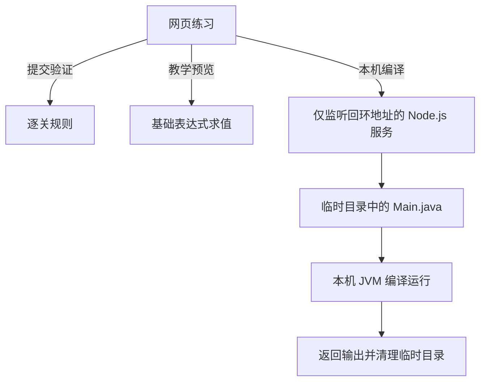

# ☕ java-path

> **面向初学者的 Java 交互式学习与编译运行工作台原型**

[](https://pursuing-coding.github.io/java-path/)
[](https://nodejs.org/)

`java-path` 是一个开箱即用的 Java 学习工作台。它集成了**课程讲解**、**官方资料**、**学习路径**、**代码编辑器**、**标准输入 (stdin)**、**控制台输出**和**自动化提交验证**。全网共有 **13 个 Level、104 个关卡**，逐步引导学习者从 `Hello World` 迈向 `Spring Boot` 实战和高并发 JVM 原理。

---

## 🔗 在线体验 / Live Demo

🚀 **直接访问在线体验网址**：👉 **[https://pursuing-coding.github.io/java-path/](https://pursuing-coding.github.io/java-path/)** 👈

> [!TIP]
> GitHub Pages 提供全部 104 关的讲解、练习和逐关检查。网页教学预览支持基本输出、简单变量、整数加法和字符串拼接。条件、循环、标准输入等需要 JDK。
> 本地运行器执行可信的单文件练习。多文件项目、依赖数据库或第三方库的课程，以及需要保留文件或观察运行中进程的练习，请按关卡说明在本地项目中运行。

---

## 🌟 核心特性

- 🖥️ **一体化交互工作台**：左侧展示课程讲解与官方规范，右侧配备完整的代码编辑器与控制台。
- ⚡ **预览和本地运行**：网页可预览一部分基础语句。本地服务使用 JDK 编译运行单个 Main.java，并支持标准输入。
- ✅ **逐关验证**：提交时按本关检查项匹配代码结构和关键步骤，满足后解锁下一关。请用 JDK 或本关指定的工具检查程序行为和实际输出。
- 📈 **进度和草稿**：草稿按关卡保存在浏览器本地，同源标签页会同步更新。
- 🌓 **主题与编辑器**：支持浅色和深色主题、标准输入、行号和专注模式。

---

## 📐 运行架构图



---

## 📂 项目目录结构

```text
java-path/
├── .github/workflows/       # GitHub Actions 自动化部署工作流
├── public/                  # 静态前端资源目录
│   ├── app.js               # 前端核心业务逻辑（编辑器事件、防抖草稿保存、Scanner 适配、关卡校验）
│   ├── styles.css           # 整体响应式与暗黑主题样式设计
│   ├── course-outline.js    # 13 个 Level 的大纲目录配置
│   ├── lesson-content-*.js  # 具体的关卡数据（介绍、拆解、示例、答案、检测项）
│   ├── submission-grading.js # 逐关提交规则
│   ├── teaching-preview.js  # 浏览器和本地服务共用的教学预览
│   ├── index.html           # 页面骨架
│   └── favicon.svg          # 网站 Favicon
│
├── scripts/                 # 辅助脚本
│   └── validate-lessons.js  # 检查课程结构、参考答案、未完成模板和教学预览
│
├── tests/                   # 测试用例目录
│   └── native-ui.js     # 基于 Safari 的端到端桌面与移动端 UI 冒烟测试
│
├── server.js                # Node.js 服务（静态文件、环境检测、本机 Java 运行）
├── package.json             # 依赖管理及启动命令
```

---

## 🚀 快速开始

### 1. 本地运行开发服务

本地编译运行建议使用 JDK 25。先确认 `java --version` 和 `javac --version` 可用。

```powershell
# 1. 克隆并进入目录
cd "java-path"

# 2. 安装依赖并启动本地服务
npm install
npm start
```

启动后，访问浏览器：
👉 **[http://127.0.0.1:4173](http://127.0.0.1:4173)**

*提示：若 4173 端口被占用，可通过环境变量更换端口启动，例如：`PORT=4273 npm start`。*

### 2. 自动化项目检查与验证

项目内置了自动化关卡合法性检测和 UI 自动化回归测试，确保前后端功能稳定：

```sh
npm ci
npm run verify
```

---

## 本机运行权限和验证范围

运行服务仅监听回环地址。JVM 子进程拥有启动该服务的本机用户权限，可以访问该用户可访问的系统资源。请只运行信任的代码。服务限制每次运行的时间和输出，并在请求结束后清理临时练习目录。若要提供多人远程运行，请在独立执行环境中配置网络、文件系统、CPU 和内存隔离。

Safari 回归测试在 macOS 上覆盖 1440、1024 和 390 像素三种宽度，并使用 JDK 验证真实运行结果。开启 Safari 开发者设置中的「允许远程自动化」并安装 JDK 后运行 `npm run verify`。
